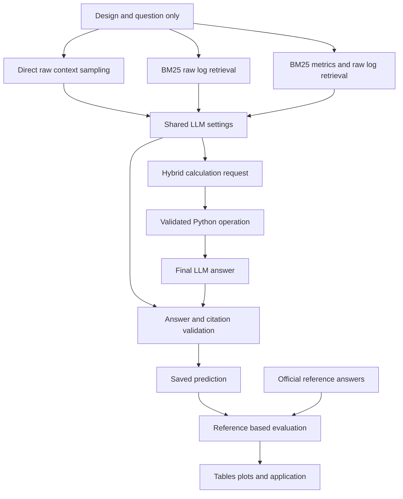

# EDA Assistant project methodology results and research analysis

Report date: 24 November 2026, Asia/Kolkata. Completed local experiment: `qwen3:4b`, protocol version 8, 40 questions and three methods. Earlier comparison: an incomplete Groq `openai/gpt-oss-20b` experiment, with 22 attempted questions per method.

This project investigates whether an LLM answers chip design log questions more accurately when it receives structured metrics alongside retrieved log excerpts. The completed local experiment contains 120 saved attempts. Under the current conservative reference scorer, Direct answered 1 of 40 questions correctly, Standard RAG answered 3, and Hybrid RAG answered 7. Hybrid improved measured correctness in this sample, while using more recorded tokens and taking longer on average than Standard RAG.

The earlier Groq experiment showed a different efficiency pattern: Hybrid used fewer tokens and had lower average latency than the other methods. That observation is real in the archived outputs, but the two experiments changed the model, serving environment, context budget, prompts and validation behavior, as well as the number of completed questions. The observations support further investigation of an interaction between the model and evidence representation. They do not isolate a provider effect.

A central qualification is that the completed local Hybrid run produced no successful deterministic calculation traces. The present accuracy improvement is evidence for the implemented combination of structured retrieval, raw retrieval and prompting. The experiment has not yet demonstrated the benefit of Python arithmetic in actual benchmark answers.

# Research problem and motivation

Electronic Design Automation, or EDA, tools generate long logs and reports while transforming a circuit design into a physical implementation. The files contain commands, progress messages, warnings, timing paths, cell statistics, power tables, routing statistics and summaries. A designer may need to find one number, establish whether a flow completed, compare two stages, or explain how a metric changed before the final design.

These tasks are difficult for a general LLM because the answer may be far from the question's wording, distributed across files, repeated at several stages, or embedded in a table with similar numbers. A correct answer requires selecting the correct design, stage, metric, unit and occurrence. For a comparison, it may also require using the right operands and performing arithmetic accurately.

For example, a question about total power can require the Total row and the Total Power column in two stage reports. Selecting the Sequential row, selecting internal power, or confusing `1.13e-01` with `0.0113` produces an incorrect answer even when the model cites a real source. A question about final cell area can refer to a different quantity from placement area, utilization, or the standard cell area reported elsewhere.

The research question is therefore: under a practical evidence budget, does combining lexical retrieval over raw logs with retrieval over structured metrics improve answer correctness compared with direct prompting and ordinary lexical RAG? A second question is whether validated numerical tools can make comparisons more reliable. A third is how the cost and reliability of these methods depend on the LLM and serving environment.

The project studies understanding of existing artifacts. It does not run synthesis, simulate Verilog, execute OpenROAD, alter a chip design or establish physical design signoff. Its outputs are answers and evidence for analysis of saved tool output.

# Research objectives and scope

The main objective is a small, reproducible comparison with actual benchmark questions, genuine inference and inspectable evidence. The intended progression is from a working implementation to a trustworthy experimental result, and then to controlled studies of why a method succeeds or fails.

The implemented comparison has three methods: Direct LLM, Standard BM25 RAG and Hybrid RAG. All three use the same local model and shared generation settings within the completed experiment. There is one benchmark attempt per question and method, corresponding to Pass@1. Operational retries are possible for failed requests; they are not a best-of-many answer search.

The first study uses three official designs and 40 selected question IDs. It excludes cross-design comparison questions, training, fine tuning, embeddings, vector databases and agent frameworks. No benchmark questions or reference answers were synthesized for this project. Unit tests use controlled client responses to test software behavior; these responses are not experimental predictions.

The original project used Groq exclusively and respected free-tier limits. The user subsequently changed the requested backend to local Ollama. The current source reflects that migration: it uses `httpx` to communicate with Ollama, rather than retaining a runtime Groq dependency. Archived Groq outputs remain available for historical analysis. The migration is a change in experimental conditions, not merely a change of URL.

# EDAFlowQA and the upstream contribution

[NVIDIA EDAFlowQA](https://github.com/NVlabs/EDAFlowQA) supplies the benchmark artifacts used here. The inspected upstream revision is `d1e43c63ae2adb69a5867328fecb0706f190a226`. Its repository contains raw design artifacts, extracted stage metrics, released question and answer pairs, and evaluation code.

The upstream README describes a pipeline that extracts information from OpenROAD logs, generates questions through Q-Tree sampling, evaluates LLM responses and calculates Pass@K. This project starts from the released data. It does not repeat the upstream question generation procedure, regenerate the benchmark, or copy the upstream inference implementation.

Three directories serve different purposes:

| Directory | Content | Use in this project |
| --- | --- | --- |
| `design_artifacts/` | Actual tool logs and reports | Direct context and raw BM25 retrieval |
| `extracted_design_stage_metrics/` | Official aggregate and per-stage JSON metrics | Structured retrieval for Hybrid |
| `qa_release/` | Released questions and reference answers | Question selection and evaluation |

The upstream Apache 2.0 license is retained as `LICENSE-EDAFlowQA`. The dataset source, repository URL and commit are recorded in the experiment configuration. These are upstream assets, while the retrieval, evidence packing, local client, calculator, runner, conservative scorer and application are independent project implementations.

The original paper's reported performance is not used as a result of this project. This study uses a small subset, different models, a custom scorer and practical context limits. Its percentages should not be presented as a reproduction of the paper's tables or ranked directly against them without aligning the protocol.

# Dataset designs and physical design stages

The selected design names combine a circuit and a technology platform. `aes_asap7` and `aes_nangate45` are AES design runs on the ASAP7 and Nangate45 platforms. `ibex_sky130hd` is an Ibex design run using the Sky130 high-density platform. These platform labels describe the saved benchmark runs; the project does not reproduce their fabrication assumptions or compare technology quality.

The official aggregate metrics represent six main stages:

| Stage | What happens | Typical information in the artifacts |
| --- | --- | --- |
| Synthesis | Logic is transformed into a technology-mapped netlist | Commands, cells, synthesis statistics |
| Floorplan | The physical design outline and initial organization are established | Area, utilization, initial timing and power |
| Placement | Cells are positioned and optimized | Placement area, displacement, timing and congestion estimates |
| CTS | Clock tree synthesis distributes the clock | Buffers, sinks, skew and timing repair |
| Routing | Signal connections are routed | Wirelength, vias, congestion, violations and timing |
| Final | The completed flow emits final reports | Final cell statistics, timing and other summary metrics |

A stage can contain many substages and individual tool passes. A command labelled as an optimization pass is not automatically an additional top-level flow stage. Confusing these levels explains some incorrect flow-count answers.

For the three designs, the currently indexed data has the following size. Raw line counts cover the `.txt` and `.rpt` files selected by the implementation, rather than every file in the upstream repository.

| Design | Raw files | Raw lines | Log chunks | Flattened metric records | Released questions |
| --- | ---: | ---: | ---: | ---: | ---: |
| `aes_asap7` | 10 | 7,120 | 397 | 574 | 80 |
| `aes_nangate45` | 10 | 5,995 | 338 | 777 | 74 |
| `ibex_sky130hd` | 11 | 8,969 | 503 | 818 | 73 |
| Total | 31 | 22,084 | 1,238 | 2,169 | 227 |

The raw files total 1,715,385 bytes. These figures describe this subset and the current index construction. Overlapping chunks intentionally repeat some lines, so the chunk count is not a count of independent evidence items.

# EDA metrics and terminology

The same word can describe different physical quantities in different reports. An answer must preserve the metric definition as well as its number. The following terms explain the main measurements encountered in the benchmark.

| Term | Meaning | How to interpret it |
| --- | --- | --- |
| Slack | Required arrival time minus actual arrival time for a setup check | Negative setup slack indicates a timing requirement was missed; hold checks have their own constraints |
| WNS | Worst negative slack, commonly reported as the worst timing slack | A more negative value generally indicates a worse violation under the same check and constraints |
| TNS | Total negative slack over the endpoints counted by the tool | Summarizes violation magnitude; it is not the same as the number of violating paths |
| Setup violation | Data reaches a sequential element too late relative to its capture requirement | Must be distinguished from a hold violation and from the count of paths printed in a report |
| Hold violation | Data changes too soon relative to the hold requirement | A separate timing problem; a setup improvement does not establish a hold improvement |
| Clock skew | Difference in clock arrival times at different clock sinks | Sign and interpretation depend on the source, destination and timing check |
| Clock sink | A terminal receiving the distributed clock, such as a register clock pin | Sink count and inserted buffer count describe different aspects of the clock network |
| Buffer | A cell inserted to drive signals, manage delay or distribute a clock | More buffers can affect area, power and timing; the desired count is task dependent |
| Cell count | Number of instances included by the selected report | May include or exclude fillers, taps, clock cells and other classes |
| Cell area | Sum of areas of the cell classes counted by a report | Must be distinguished from die area, core area and placement-area summaries |
| Utilization | A stated occupied-area fraction relative to the tool's chosen available area | Its denominator and included cell types matter |
| Internal power | Power associated with internal cell activity | One component of a power table, not total design power |
| Switching power | Power associated with charging and discharging switched capacitances | Depends on the activity and estimation assumptions |
| Leakage power | Power consumed through leakage currents | Distinct from internal and switching power |
| Total power | The total defined by the report, usually combining the power components | Select the intended group row as well as the Total column |
| HPWL | Half-perimeter wirelength of a net's bounding box, summed as specified | A geometric estimate used in placement; it is not identical to final routed wirelength |
| Routed wirelength | Length of the interconnect represented by the routing report | Can differ from an earlier placement estimate even without a reporting error |
| Via | A connection between routing layers | Via count describes inter-layer connectivity, rather than total route length |
| Congestion | Demand for routing resources relative to available capacity | The exact definition depends on the tool's grid and reporting convention |
| DRC | Design rule checking | A violation count concerns geometric rules; it is different from timing violations |
| Runtime | Elapsed or stage execution time as labelled by the report | Must preserve stage scope and the stated time basis |
| Memory usage | Memory reported for a command or stage | Peak, final and resident-memory values are not automatically comparable |

Units are part of the answer. Time may be reported in seconds, nanoseconds or picoseconds; power in watts or milliwatts; length in micrometres; and area in square micrometres. Scientific notation must be read correctly: `1.13e-01` equals 0.113, while `1.13e-02` equals 0.0113. A percentage, a percentage-point difference and a fractional ratio describe different quantities.

Signed improvements also need care. If WNS changes from -20 to -10 in the same unit, the signed difference is +10 and the violation magnitude has decreased. A generic percentage-change formula with a negative baseline is a mathematical convention, not automatically the most useful engineering interpretation. Every comparative answer should identify its baseline, final value, sign convention and unit.

The project follows the released reference units for evaluation and uses metric-name heuristics for some structured evidence units. It does not independently validate every tool's unit configuration. An apparent unit inconsistency between a raw log, extracted metric and reference should therefore be investigated before drawing a physical conclusion.

# Questions categories and sample selection

The four benchmark categories capture different kinds of reasoning:

| Category | Main task | Common difficulty |
| --- | --- | --- |
| `flow_execution` | Identify the run, its completion status, errors or stages | Distinguishing high-level flow facts from individual messages |
| `single_stage` | Find information about one stage | Selecting the correct metric, row, column and occurrence |
| `multi_stage` | Compare or connect information across stages | Retrieving every required stage and preserving their associations |
| `stage_to_final` | Relate intermediate behavior to the final outcome | Integrating several facts, changes, paths or optimization effects |

Question selection uses seed 42. The implementation loads question-only records, normalizes question wording, shuffles category pools and selects categories in a round-robin order. It rejects exact normalized duplicates and candidate wordings with a `SequenceMatcher` similarity of at least 0.85 to an already selected question.

The selected sample contains 9 flow questions, 11 single-stage questions, 10 multi-stage questions and 10 stage-to-final questions. The three releases contain only 9 flow questions in total, which constrains an exactly balanced sample. Design representation is 17 AES ASAP7 questions, 10 AES Nangate45 questions and 13 Ibex Sky130HD questions. The sampling process encourages category balance but does not enforce equal design counts.

The 40 IDs are unique when combined with design. They are not 40 entirely independent question families. Removing the `_P<number>` suffix and grouping by design leaves 27 ID families. Some family members are paraphrases, while others ask different details within a shared topic. The present text similarity rule does not enforce one question per family. This matters for generalization and uncertainty: related items can make a method's result depend heavily on a small number of underlying tasks.

The selected IDs are saved in `results/experiment_config.json`, and reproduced in the appendix. Difficulty tags and the leading `<Q...>` marker are removed from model prompts. They do not serve as hidden answer hints. All selected original question strings are shorter than the implementation's 550-character question cap, so that cap did not truncate this sample.

# Data schemas and reference answer isolation

A question record exposed to inference contains the question ID, design, category, wording and an optional stage field. It does not expose the reference answer. Official references may be strings, numbers, lists or nested objects, rather than one uniform answer type.

The aggregate metrics JSON has fields including `design_name`, `sub_design_names`, `design_info`, `log_file`, `timestamp`, `flow_execution_summary` and `stages`. The flow summary includes run status, stage count and stage descriptions. The stage list contains stage names, metrics and nested substages. The index flattens scalar leaves from the flow summary and stages into individually searchable records.

Each flattened record includes a design, stage, metric name, value, inferred or explicit unit, JSON path and source file. A typical path is `stages[5].metrics.cell_counts.total_cell_area`. This path is a location in the official data, not a generated answer. It can be traced to its JSON source, although this implementation does not always map that JSON field back to the original raw log line.

Reference isolation is an application boundary. `src.dataset` loads the released QA JSON and projects away answer fields before returning question objects. `src.evaluation` explicitly reads the reference answers. Retrieval indexes raw artifacts and metric JSON, never the QA answers, prediction files or evaluation CSV. The runner sends question text and selected evidence to inference and evaluates only after receiving an output.

The benchmark files coexist on the same filesystem, and JSON parsing initially loads the release object before projection. This is not an operating-system security sandbox between labels and inference. Its practical protection is the restricted data flow and tests. Human inspection of reference answers also creates experimental knowledge, so the smoke sample used during debugging must be regarded as development data.

Structured metrics are extracted representations of the same underlying run. Their use is authorized evidence for the Hybrid method. They can contain extraction mistakes, missing fields or weak unit metadata. They are useful evidence, but should not be treated as infallible ground truth simply because they are JSON.

# Shared architecture and evidence flow

The project keeps the workflow sequential and explicit. A design and question enter one method. That method prepares evidence, calls the same LLM, validates the response and returns an answer record. Evaluation later compares that record with the official reference.



The conditional calculation branch belongs to Hybrid. There are no autonomous agents, planning loops or arbitrary generated programs. A successful calculation can trigger one additional answer call. The completed local run did not successfully take that branch.

Evidence records use method-specific identifiers such as `D0000`, `L00001` and `M00001`. A citation is interpreted within the evidence actually supplied for that answer, not as a globally unique ID across every design or experiment. The design, source and location remain necessary for provenance.

# Method A Direct LLM

Direct provides a deterministic sample of raw log material without question-based retrieval. The current implementation chooses the main log and one representative report from each numbered stage group. Approximately 40% of its evidence allowance is assigned to the main log, and the remainder is divided among those reports. It takes head and tail excerpts, preserving source file and line references.

The evidence cap is 6,000 characters. Actual Direct contexts are 4,973 characters for AES ASAP7, 5,344 for AES Nangate45 and 5,430 for Ibex Sky130HD. The sampler can leave capacity unused because it works with lines and stage allocations. Its report choice is deterministic, including a lexicographic representative from each numbered group; it is not an expert-selected best report for each question.

This is a constrained Direct baseline. It does not show the LLM an entire design's logs. Many middle sections are omitted before inference, and every question for the same design receives the same evidence sample. Poor performance can therefore arise even when the raw dataset contains the answer. Direct should be described as direct prompting with deterministic truncated context, rather than unrestricted long-context reasoning.

The fixed context has another implication: repeated prompts share a large prefix within a design. That can potentially help serving caches, depending on the server's caching behavior. The saved telemetry does not measure cache hits, so this remains one possible explanation for Direct's unusually low local latency.

# Method B Standard BM25 RAG

Retrieval-augmented generation, or RAG, uses a search step to choose evidence before generation. Standard RAG searches raw logs and reports only. It does not access structured metrics as answer evidence.

The implementation divides files into 24-line chunks with six lines of overlap. The next chunk begins 18 lines after the previous one. Every chunk carries a source filename, start and end line numbers and raw text. Overlap reduces the chance that a fact at a boundary is completely lost, but it also creates duplicate context.

BM25 is a lexical relevance scorer. In broad terms, it rewards matching query words that are informative within the collection, accounts for repeated terms with diminishing returns, and normalizes for document length. The project uses `rank-bm25`; no embedding model, vector store or model training is required. Filenames are included in the indexed text because stage names may be visible there even when absent from the chunk body.

Token preparation lowercases text, splits identifiers, removes common words and normalizes a few variants, including routing to route and some plural endings. Count queries over metrics receive a small query expansion for the word total. These are simple lexical rules, not semantic understanding. They can improve one match and weaken another.

Standard RAG requests eight ranked chunks and initially limits selection to two per source, with a fallback if needed. The evidence packer fits them under the total character allowance and limits each log excerpt to 1,600 characters. The actual visible excerpt is saved, so later analysis can inspect what the model received.

The method is vulnerable to lexical and layout errors. A query mentioning routing may retrieve an optimization message rather than final routing metrics. A 24-line window may split a power table from its header or its Total row. Source diversification can improve coverage across stages, yet it can also prevent several necessary chunks from one long main log from being supplied together.

# Method C Hybrid RAG

Hybrid searches both the official structured metrics and raw artifacts. It requests up to 12 metric records and five raw chunks. Metrics initially receive 58% of the evidence character budget; raw evidence uses the remaining space after the actual rendered metrics. All evidence together remains under the same nominal 6,000-character cap.

The structured representation can make a requested value easier to find. A field named `total_cell_area` is more direct than a table row buried among tool messages. A stage summary can present a count and the stage types without requiring the LLM to reconstruct them from many execution messages. Raw evidence remains useful for commands, warnings, tables and facts absent from the aggregate metrics.

Hybrid also includes a validated numerical interface. The LLM can request `difference`, `percentage_change`, `ratio`, `minimum` or `maximum` over visible numeric metric IDs. Python checks the request and performs the operation. If the calculation succeeds, a second model call is allowed to formulate an answer from the verified result.

Hybrid is not guaranteed to be more accurate or cheaper. Metric paths can be long, nested and difficult to interpret. Retrieved records can match words while containing irrelevant values. A fixed allocation can spend context on unnecessary metrics while excluding a needed raw table. The additional instructions also make the prompt longer and require the model to decide whether to answer, request arithmetic or abstain.

An important presentation limit is that the compact metric text renders an ID, JSON path, value and unit, while stage names primarily participate in search and the saved record. A path containing `stages[5]` is less explicit to the model than a labelled final-stage record. This is a plausible clarity problem to examine in future work.

# Deterministic numerical reasoning and its limits

The calculator accepts a small JSON contract with an operation and evidence IDs. It rejects unknown operations, unknown or repeated IDs, nonnumeric values, booleans, non-finite numbers and incompatible unit strings. Difference, percentage change and ratio require exactly two operands. Minimum and maximum accept between two and 12 operands. Zero denominators and zero percentage-change baselines are rejected.

For operands `a` followed by `b`, the operations mean:

| Operation | Result | Interpretation |
| --- | --- | --- |
| `difference` | `a - b` | Signed change from baseline `b` to result `a` |
| `percentage_change` | `(a - b) / abs(b) * 100` | Signed percentage change using the magnitude of the baseline |
| `ratio` | `a / b` | Multiplicative comparison |
| `minimum` | Smallest supplied value | Extremum over the supplied records |
| `maximum` | Largest supplied value | Extremum over the supplied records |

For example, 0.156 W minus 0.113 W equals 0.043 W. This is an explanation of the calculation rule, not a claim that the completed Hybrid benchmark executed this operation.

The returned trace records the operation, operand IDs, operand values, result and unit. The answer validator checks that the model's reported leading numeric result agrees with Python within a tight numerical bound. It also checks citation IDs. This prevents arbitrary code execution and catches some arithmetic misreporting.

Several limits remain. The calculator accepts structured numeric metric records, not numbers selected from raw text. It requires equal unit strings rather than converting compatible units. Correct arithmetic on the wrong stage's values still gives a wrong answer. Equal empty unit strings do not establish that two metrics have the same physical dimension. The final consistency check primarily verifies a numeric result, rather than fully validating a multi-field narrative and all unit semantics.

The Hybrid guard also looks for particular arithmetic phrases in the question. This is narrower than a full intent parser. A request phrased as cumulative impact or change in a metric may escape it. Questions requiring several derived values exceed the convenience of one simple operation followed by a scalar-oriented final answer prompt.

The completed local run has zero successful calculation traces, zero saved recognized calculation requests and one model call per Hybrid attempt. Four Hybrid answers were changed to abstentions because an arithmetic answer lacked a verified trace. Consequently, the current experiment tests the retrieval mixture and its validation policy, while the intended numerical tool contribution remains unmeasured on real benchmark answers.

# LLM integration and generation settings

The local configuration uses:

```dotenv
LLM_API_KEY=ollama
LLM_BASE_URL=http://localhost:11434/v1
LLM_MODEL=qwen3:4b
```

The key string is a local compatibility placeholder. Actual secrets are excluded through `.gitignore`; none are included in this report. The client checks the configured model through `/v1/models` and makes a real JSON chat request before an experiment proceeds. It derives Ollama's native `/api/chat` endpoint to explicitly control JSON output and thinking behavior.

| Setting | Completed local experiment | Earlier Groq configuration |
| --- | --- | --- |
| Model | `qwen3:4b` | `openai/gpt-oss-20b` |
| Temperature | 0 | 0 |
| Evidence character cap | 6,000 | 3,500 |
| Output token cap | 768 | 512 |
| Context window explicitly requested | 8,192 tokens | Not recorded in the archived config |
| Thinking or reasoning control | `think: false` | `reasoning_effort: low` |
| Repeat penalty | 1.0 | Not recorded in the archived config |
| Protocol version | 8 | No equivalent field saved |

Temperature zero supports a stable baseline, but it is not proof that a particular model is operating at its best setting. It also does not guarantee bit-for-bit reproducibility across serving versions or hardware. Qwen documents different suggested sampling settings for its thinking and non-thinking modes; those suggestions motivate a future controlled comparison, rather than establishing that a higher temperature will improve this EDA task. [Qwen3-4B model card](https://huggingface.co/Qwen/Qwen3-4B).

JSON mode constrains the output format but does not guarantee the required fields, correct evidence IDs or a truthful answer. Ollama supports both JSON mode and schema-based formats; the implemented request uses `format: json` with Python-side validation. Thinking is explicitly disabled in the completed local run. [Ollama chat API](https://docs.ollama.com/api/chat).

Prompt cleanup removes benchmark wrappers. The evidence precedes the question, so the final instruction remains close to the output. The system prompt asks for concise answers, correct table rows and columns, and citations. Missing units do not force an abstention when a shown number is usable. Missing or invalid citations are flagged separately from answer correctness, while unsupported calculations can cause an abstention.

# Reliability and resumable execution

The experiment runner defaults to Direct and RAG. Hybrid can be run later with the same saved sample and configuration. This reduces the chance that an issue in Hybrid prevents a usable baseline comparison from finishing.

Each result is appended to JSONL, flushed and synchronized to disk. Resume keys combine design, question ID and method. Re-reading predictions uses the latest row for a key, which supports an explicit retry without counting duplicate attempts as additional benchmark questions. A nonblocking file lock prevents two copies of this runner from writing overlapping experiments concurrently.

The client uses bounded retries and a timeout of 120 seconds. Selected transient HTTP errors can be retried, while a deterministic token-repeat abort is not repeatedly submitted. An individual generation or parsing error becomes a saved failure row and the runner continues. A connection failure stops the run with completed outputs retained. Tables and plots are refreshed periodically and on exit.

The configuration guard compares settings and selected IDs before combining results. `--fresh` archives the previous canonical outputs and begins a new comparison. It should be used once to begin a new run, not again when adding Hybrid or resuming interrupted Direct/RAG results. A retry of API failures is an operational recovery choice; its results should be distinguished from the original first-attempt snapshot when reporting strict Pass@1.

This machinery addresses completion and reproducibility, not model correctness. A fully attempted run may contain abstentions and failures. In the completed local study all 120 target rows exist, but one Direct attempt records an API failure.

# Answer status abstention and failure

An answered row means the accepted answer field is non-null. It does not mean the answer is correct or fully supported. An abstained row means no answer was returned or an answer was rejected by a validation rule. An API failure means the request or response handling failed before a usable result was obtained.

| Status | What it means | Effect on the benchmark |
| --- | --- | --- |
| `answered` | A non-null answer was retained | Scored against the reference and checked for citations |
| `abstained` | No accepted answer | Counts as incorrect and reduces coverage |
| `api_failure` | Inference or response processing failed | Counts as incorrect and is tracked separately |

Rows are not silently discarded. The question, method, evidence and available response information remain inspectable. A deliberate refusal due to insufficient evidence differs from a model failing to produce a required field, even though both can currently appear under abstention. The validation reason and raw model response are therefore important for diagnosis.

Four outputs in the local results contain the literal string `null`: two Direct and two Hybrid. A JSON string containing those letters is different from the JSON null value. The current code counts these strings as answered. They are incorrect answers and are not evidence of successful coverage. A future semantic-empty normalization would reduce Direct coverage from 20/40 to 18/40 and Hybrid coverage from 33/40 to 31/40 if these four cases were reclassified, without changing their correctness. This report leaves the saved classifications unchanged.

The local Hybrid abstentions comprise four with the explicit unverified-arithmetic reason and three without a validator error. Direct has 19 abstentions and one API failure; RAG has six abstentions. The single Direct API failure contains the Ollama message `prediction aborted, token repeat limit reached`. The completed run demonstrates that this error no longer prevents the other questions from being attempted.

# Evaluation methodology

Pass@1 measures whether the single accepted attempt for a question is correct under the chosen scoring rule. With one attempt per question and a fixed denominator, it reduces to the fraction of selected questions answered correctly. The project does not use repeated model generations to select the most favorable answer.

The evaluator combines normalized exact match, numerical comparison, conservative structured equivalence and limited extractive prose matching. Exact match alone would reject many correct formatting or unit variations. An unrestricted similarity score could instead accept an incomplete or misleading answer. The implemented rules take a conservative middle position and flag unresolved cases for review.

Normalization reduces differences in case, whitespace and punctuation. Numerical scoring parses recognized units and compares compatible values after conversion, with 1% relative tolerance and small dimension-specific absolute tolerances. Supported examples include picoseconds and nanoseconds, micrometres and millimetres, square micrometres and square millimetres, and milliwatts and watts. A bare predicted number is interpreted using the explicit reference unit. That convention avoids rejecting useful extractions, but it cannot prove that the model understood the unit.

Structured equivalence can tolerate renamed keys when the corresponding values match. It still expects all required fields, matching object sizes and matching list order. A reference with power at two stages and their difference is not fully satisfied by one correct stage value. Simple prose can be accepted for small flat reference objects if every required field is explicitly present. Other paraphrases remain flagged `needs_review` and are not automatically accepted.

The scorer is heuristic. It can undercount valid answers with a different schema, additional harmless fields or list order. Key matching and prose extraction can also make mistakes. A `needs_review` flag means automatic scoring was inconclusive under these rules; it does not mean the answer is probably correct. There are 69 flagged rows in the local evaluation: 17 Direct, 28 RAG and 24 Hybrid. A reviewed result should be reported separately from the untouched automatic score.

Numerical question accuracy uses full-answer correctness on references containing at least one parsable number. There are 36 such questions. This includes some run-status questions containing counts or exit codes, so the metric is not a pure arithmetic benchmark. The separate numerical-value match field provides a narrower view when the predicted and reference answer structures are numerically comparable.

Citation validity checks that every cited ID belongs to the evidence supplied for that prediction. It does not establish that the cited lines entail the answer, that the correct stage was used or that every requested claim is supported. In this local run many incorrect answers have valid citations. Provenance and factual correctness must therefore remain separate measurements.

The official `pass_k_metric_calculation.py` and `llm_response_eval.py` were inspected. They provide Pass@K calculations, structured answer comparisons and optional LLM-based judging. The project currently uses its own transparent Pass@1 scorer and does not execute the upstream judge. This avoids introducing additional model judgments and calls into the current comparison, but the scoring is not identical to the upstream evaluation. An extension could reuse compatible upstream structural comparisons as a secondary, separately labelled metric.

# Metric definitions and accounting boundaries

Every method has a denominator of 40 selected questions for overall accuracy, coverage, abstention rate, API failure rate and citation validity rate. Unattempted questions in an incomplete experiment remain missing and contribute no successes to these full-target rates. Within-category accuracy uses the selected count for that category. Numerical accuracy uses 36 for every method.

| Measurement | Definition or interpretation |
| --- | --- |
| Overall accuracy | Fully correct answers divided by 40 |
| Numerical question accuracy | Fully correct answers on numeric-reference questions divided by 36 |
| Answer coverage | Retained answers divided by 40 |
| Abstention rate | Abstained rows divided by 40 |
| API failure rate | Failed rows divided by 40 |
| Citation validity rate | Rows with valid nonempty citations divided by 40 |
| Average latency | Mean response time over non-API-failure rows, including abstentions |
| API calls | Recorded inference request attempts, including recorded retries |
| Total tokens | Sum of saved prompt and completion counters |

Latency begins inside the question-answer function and can include retrieval, initial index construction and validation, as well as the model call. It excludes overall dataset setup, the startup connectivity test, evaluation, plot generation and application startup. It is therefore neither a pure model decode time nor the wall-clock duration of the full command.

Token usage represents reported counters for saved responses. An error row uses zero counters when no usable token report is available; that means unavailable usage, not proof that the server did no work. Retries can also perform work for which a complete token record is not returned. Connectivity usage is returned by the client but is not persisted by the runner in the benchmark prediction totals. Smoke outputs are separate when retained. Consequently, the token tables describe recorded benchmark-response usage, rather than a complete provider or machine resource audit.

Local tokens have no per-token provider invoice in this configuration. They still imply compute, memory use, electricity and waiting time. These resources were not measured. Tokens from different models also use different tokenizers and cannot be treated as identical units of computational work.

# Completed local results

All three local methods have 40 unique saved rows. The complete comparison is available in `results/predictions.jsonl`, `results/evaluation.csv`, `results/summary.csv` and `results/experiment_config.json`.

| Metric | Direct | Standard RAG | Hybrid RAG |
| --- | ---: | ---: | ---: |
| Attempted questions | 40/40 | 40/40 | 40/40 |
| Correct answers | 1 | 3 | 7 |
| Overall accuracy | 2.5% | 7.5% | 17.5% |
| Numerical question correctness | 0/36 | 2/36 | 6/36 |
| Numerical question accuracy | 0.0% | 5.6% | 16.7% |
| Retained answers | 20 | 34 | 33 |
| Reported answer coverage | 50.0% | 85.0% | 82.5% |
| Abstentions | 19 | 6 | 7 |
| API failures | 1 | 0 | 0 |
| Valid-citation rows | 18 | 32 | 31 |
| Citation validity rate | 45.0% | 80.0% | 77.5% |
| Flagged for review | 17 | 28 | 24 |
| Average nonfailure latency | 2.56 s | 13.04 s | 14.66 s |
| Recorded API calls | 40 | 40 | 40 |
| Recorded total tokens | 104,920 | 105,840 | 115,011 |

Hybrid improves measured accuracy by 10 percentage points over RAG and 15 percentage points over Direct. Expressing the same result as a 2.33-fold gain over RAG or a sevenfold gain over Direct is mathematically possible, but the count difference of four or six questions is more informative at this sample size.

RAG and Hybrid substantially increase answer coverage compared with Direct. They also retain many incorrect answers. Among the rows labelled answered, strict correctness is 1/20 for Direct, 3/34 for RAG and 7/33 for Hybrid. These conditional rates are useful diagnostics but should not replace the fixed-denominator benchmark results. Coverage alone would give an overly favorable picture of reliability.

Hybrid is not strictly better across all metrics. It has one more abstention and one fewer valid-citation row than RAG, uses 8.7% more recorded tokens, and has 12.4% higher mean latency. The current result is an accuracy-efficiency tradeoff in this particular local setup.

# Category and design analysis

The category results explain why the multi-stage and stage-to-final portions of the plot initially appeared blank. Their bars have zero height because all methods scored zero fully correct answers in both categories. The plot now labels correct counts explicitly.

| Category | Selected questions | Direct | Standard RAG | Hybrid RAG |
| --- | ---: | ---: | ---: | ---: |
| Flow execution | 9 | 1/9, 11.1% | 1/9, 11.1% | 3/9, 33.3% |
| Single stage | 11 | 0/11, 0.0% | 2/11, 18.2% | 4/11, 36.4% |
| Multi stage | 10 | 0/10 | 0/10 | 0/10 |
| Stage to final | 10 | 0/10 | 0/10 | 0/10 |

These zeros combine several mechanisms. Some questions were abstained on, some produced a wrong value or wrong stage, and others returned only a subset of the requested facts. The strict whole-answer score gives no partial credit. The result therefore establishes a failure to produce automatically accepted complete answers, rather than proving that every retrieved fact was wrong.

All 10 multi-stage and all 10 stage-to-final questions were attempted by every method. The categories are not missing from the selected sample or evaluation table. Within multi-stage, Direct abstained three times, RAG twice and Hybrid four times. Within stage-to-final, Direct abstained seven times and had one API failure, while RAG and Hybrid each abstained once.

Correctness by design is also uneven:

| Design | Selected questions | Direct correct | RAG correct | Hybrid correct |
| --- | ---: | ---: | ---: | ---: |
| `aes_asap7` | 17 | 1 | 2 | 4 |
| `aes_nangate45` | 10 | 0 | 1 | 1 |
| `ibex_sky130hd` | 13 | 0 | 0 | 2 |

The per-design groups are small and have different question mixtures. These counts cannot establish that one circuit or technology is intrinsically harder. They identify where to inspect evidence coverage and answer failures in the next analysis.

# Examples of successes and failures

The final-cell-area question for AES ASAP7 is a useful success case. RAG and Hybrid returned `4181.54`, matching the reference `4181.54 um^2` under the documented bare-number convention. The structured metric directly names total cell area. This supports the value of a specific searchable field, but does not establish that every area measure is interchangeable.

Hybrid also correctly returned the six stage types for the AES ASAP7 and Ibex flow questions. It accepted a concise object with a renamed count key while preserving the expected values. This illustrates why conservative structural equivalence is useful in addition to exact match.

The AES ASAP7 power comparison illustrates a substantive numerical failure. RAG's output included a floorplan value of `0.0113` even though the evidence displayed `1.13e-01`, or 0.113. It then reported a difference using the wrong magnitude. This is more than a formatting difference: the scientific notation was misread. A valid source ID did not prevent the error.

Several stage-to-final answers contained only one correct fragment. For example, a reference requested routing and final setup and hold violation counts plus timing gaps, while a prediction returned the routing counts only. A partial-credit score could record that some information was recovered, but the full answer remains incomplete.

Other failures involved wrong commands, wrong stage associations, repeated or generic text, and insufficient evidence. A complex reference describing paths or optimization effects can require several related fields, while the model may return a single number. The current prompt's emphasis on concise scalar answers and the calculator's scalar-oriented final prompt can conflict with these multi-part requirements.

These examples support a diagnosis based on multiple failure layers: evidence unavailable in the selected representation, evidence not retrieved, evidence cut off, incorrect reading of visible evidence, unsupported arithmetic, incomplete answer composition and conservative evaluation mismatch. A single aggregate accuracy number cannot distinguish these layers.

# Token usage in the completed local run

Recorded token use separates input from output:

| Token measurement | Direct | Standard RAG | Hybrid RAG |
| --- | ---: | ---: | ---: |
| Prompt tokens | 103,364 | 102,243 | 112,827 |
| Completion tokens | 1,556 | 3,597 | 2,184 |
| Total tokens | 104,920 | 105,840 | 115,011 |
| Mean prompt tokens per selected attempt | 2,584.1 | 2,556.1 | 2,820.7 |
| Mean completion tokens per selected attempt | 38.9 | 89.9 | 54.6 |
| Largest recorded completion | 162 | 320 | 449 |

Hybrid generated 1,413 fewer completion tokens than RAG, a reduction of about 39.3%. Its prompt, however, used 10,584 more tokens, an increase of about 10.4%. The input increase outweighed the output saving, leaving 9,171 additional recorded total tokens.

The extra input is consistent with longer structured paths, the calculation instructions, and the actual evidence packing. A character cap does not guarantee equal token counts, particularly for punctuation-heavy JSON paths, identifiers and numeric strings. It also does not force every method to fill its allowance. Hybrid's compact-looking records can therefore consume more model tokens than a similar number of prose characters.

No saved successful local response reached the 768-token output cap. Raising that cap alone has little direct support as a remedy for these particular recorded errors. The one aborted request lacks full generation telemetry, so this observation does not describe its internal token sequence. It describes the 119 nonfailure responses whose usage was saved.

# Latency in the completed local run

| Nonfailure latency | Direct | Standard RAG | Hybrid RAG |
| --- | ---: | ---: | ---: |
| Mean | 2.56 s | 13.04 s | 14.66 s |
| Median | 1.31 s | 12.78 s | 13.95 s |
| 95th percentile | 8.74 s | 23.66 s | 19.64 s |
| Maximum | 9.99 s | 26.74 s | 37.91 s |

Hybrid has higher mean latency than RAG, but its empirical 95th percentile is lower. The distributions therefore do not support a blanket statement that every Hybrid response is slower. With only 40 observations, tail statistics are also sensitive to individual requests and serving conditions.

Direct is much faster locally even though its recorded prompt token total is similar to RAG. Its outputs are shorter and its evidence prefix repeats for a design, both of which could reduce work or waiting. It also frequently abstains, which can end an answer quickly. The result should not be described as a successful fast method without also reporting its 2.5% strict accuracy and low coverage.

The response timer includes retrieval and can include the first BM25 index build in a process. The runner caches indexes for the three designs. This can create differences between first-use and later questions. Method order, prompt prefix reuse and the fact that Hybrid ran in a separate command can also affect the measurements.

The project does not save model load time, prefill time, decode time, cache-hit counts, processor placement or background system load. Those omissions prevent a causal decomposition of the response-time differences.

# Earlier Groq experiment and the efficiency reversal

The archived Groq experiment has 69 raw JSONL rows but 66 unique design/question/method keys after the same latest-row interpretation used by the runner. There are 22 unique attempted questions for each method, rather than 40. The archived summary retains the full-target denominator of 40 for accuracy and coverage.

| Archived Groq measurement | Direct | Standard RAG | Hybrid RAG |
| --- | ---: | ---: | ---: |
| Unique attempted questions | 22 | 22 | 22 |
| Correct answers | 2 | 1 | 7 |
| Correct among attempted, exploratory | 9.1% | 4.5% | 31.8% |
| Correct divided by full 40-question target | 5.0% | 2.5% | 17.5% |
| Retained answers | 4 | 4 | 9 |
| Abstentions | 18 | 18 | 12 |
| API failures | 0 | 0 | 1 |
| Mean nonfailure latency | 13.62 s | 11.20 s | 8.10 s |
| Recorded prompt tokens | 40,454 | 35,265 | 29,874 |
| Recorded completion tokens | 1,090 | 1,511 | 1,597 |
| Recorded total tokens | 41,544 | 36,776 | 31,471 |
| Recorded API calls | 24 | 24 | 24 |

Within that partial Groq experiment, Hybrid used 14.4% fewer recorded tokens than RAG and had 27.7% lower mean latency. Relative to Direct, it used 24.2% fewer tokens and had 40.6% lower mean latency. This verifies the user's observation within the archived results.

The input-output split gives a more precise explanation. On Groq, Hybrid's recorded input was 29,874 tokens compared with RAG's 35,265. Its output was actually slightly larger: 1,597 versus 1,511. Its total saving came from the smaller input. On local Qwen, the direction of the input difference reversed, while Hybrid's output became shorter. It is therefore inaccurate to explain both experiments simply by saying Hybrid always generates shorter answers.

Comparing raw totals of 31,471 Groq Hybrid tokens and 115,011 local Hybrid tokens would confound 22 versus 40 questions. Their recorded mean totals were about 1,430.5 and 2,875.3 tokens per selected attempt, respectively, but even these averages reflect different tokenizers, budgets, prompts and response policies.

Restricting local results to the same 22 question keys improves sample alignment. Local Direct scored 0/22, RAG 1/22 and Hybrid 3/22, while the archived Groq scores were 2/22, 1/22 and 7/22. Local recorded token totals on those keys were 55,910, 60,122 and 65,545. The remaining protocol differences still prevent attribution to model or provider alone. The archived scoring implementation and prompts were not preserved as a complete independent source snapshot, which further limits exact reconstruction.

# Possible reasons for the Groq and local differences

The strongest explanation supported by the saved counters is a difference in the input actually supplied and counted. The local evidence budget increased from 3,500 to 6,000 characters, the Hybrid instruction became more explicit, and retrieval and evidence packing changed during debugging. These changes can consume more input even before the model starts answering.

Different tokenizers are another direct comparison limit. A JSON path, underscore-heavy identifier or scientific number can be split differently by two models. Equal characters are neither equal tokens nor equal compute. Within one model, token totals can be compared as usage; across models, they are primarily measures in each model's own encoding.

Model capability and task fit are plausible contributors to answer quality and instruction following. The Groq model is a mixture-of-experts model with 20 billion total parameters and roughly 3.6 billion active per token, while Qwen3-4B is a dense 4-billion-parameter model. This is not a simple fivefold active-compute comparison. Their training, architectures, reasoning modes and ability to follow the calculation contract differ. Parameter counts alone cannot predict this task's result. [Groq GPT OSS 20B documentation](https://console.groq.com/docs/model/openai/gpt-oss-20b), [Qwen3-4B model card](https://huggingface.co/Qwen/Qwen3-4B).

Hybrid adds responsibilities to the prompt: interpret two evidence formats, distinguish stage indices, select operands, decide whether a tool is needed and return valid JSON. A smaller model can benefit from explicit metrics on simple questions while struggling with the full contract on complex questions. The completed run's zero recognized calculation requests is consistent with such a contract-following problem, but it does not establish that model size is the cause.

Serving differences can affect response time independently of correctness. A managed Groq service and a local Ollama process do not have the same execution resources, scheduling, caching or memory behavior. Local CPU placement, available acceleration, memory pressure, model loading, thermal limits and other applications are possible factors. The run did not record them, so it would be unsupported to assert that the model ran only on CPU or that thermal throttling occurred. Ollama documents ways to inspect processor placement, queueing and model lifetime for a future measurement. [Ollama FAQ](https://docs.ollama.com/faq).

Input processing, output generation, queueing and network time contribute differently to total latency. More input can increase prefill work even when output is shorter. More generated tokens generally increase decoding work. A remote free-tier request can also include network delay, waiting or retries. The historical measurements do not isolate these terms. [Groq latency documentation](https://console.groq.com/docs/production-readiness/optimizing-latency).

No successful local Hybrid calculation used a second call. Extra calculator round trips therefore do not explain the local mean latency increase in this completed run. The additional input and different serving behavior are more plausible candidates to test. The archived Groq data contains no successful calculation traces either; its 24 recorded calls per 22 attempted questions include operational call accounting and do not establish successful arithmetic-tool use.

Local performance is also not uniformly worse. Direct's local mean latency of 2.56 seconds is below its archived Groq mean of 13.62 seconds. RAG and Hybrid are slower locally under their respective recorded conditions. A careful observation is: the efficiency ranking changed across two model-and-protocol configurations, while Hybrid retained the highest automatic accuracy within each experiment.

# What the present evidence supports

The completed local experiment demonstrates that the system can finish a fixed 40-question comparison for all three methods and preserve its outcomes. It establishes a reproducible working baseline, including unsuccessful answers, rather than only favorable examples.

It supports the descriptive claim that Hybrid achieved the highest automatic whole-answer accuracy in this sample. The correct-count gain comes from flow execution and single-stage retrieval. It does not show an improvement in accepted multi-stage or stage-to-final answers, and it does not establish that numerical tooling caused the gain.

The results also support a practical distinction between provenance and correctness. RAG has 32 valid-citation rows but only three correct answers; Hybrid has 31 valid-citation rows but only seven correct answers. An existing citation is a useful audit trail, not proof that the model interpreted it properly.

The structured source is incomplete for some requested topics. None of the three currently flattened aggregate JSON files contains a metric path including power. Raw power tables do exist. For these questions, Hybrid's structured-only calculator cannot obtain operands simply by retrieving a named power metric from the current aggregate index. This is a representational gap, not a lack of raw evidence in the dataset.

The observed failure pattern suggests that improving evidence coverage, preserving stage associations and completing multi-field answers may be more urgent than changing one sampling parameter. This is a hypothesis informed by examples, not an experimentally isolated ranking of possible fixes.

# Uncertainty and threats to validity

The sample is small, contains related question families and was used for debugging. With 40 questions, one additional correct answer changes accuracy by 2.5 percentage points. Approximate 95% Wilson intervals are 0.4% to 12.9% for Direct, 2.6% to 19.9% for RAG and 8.7% to 32.0% for Hybrid. These intervals assume independent items and therefore understate the complication introduced by repeated families and development exposure.

A paired comparison is more appropriate than treating methods as unrelated samples. Hybrid alone was correct on five questions where RAG was incorrect; RAG alone was correct on one question where Hybrid was incorrect; both were correct on two. A two-sided exact paired test on those six discordant items gives approximately 0.219. This is an exploratory calculation and does not establish a reliable Hybrid-versus-RAG advantage beyond the current sample. Related questions, scorer uncertainty and multiple possible analyses further limit significance claims.

The conservative scorer may undercount equivalent answers, while its heuristic key and prose matching can also accept an unsuitable match. Numerical tolerance and the bare-number unit convention affect outcomes. The study should preserve automatic results and add any reviewed or alternative scoring as distinct outputs rather than silently replacing the baseline.

The Direct context omits much of the dataset and uses less than the full character allowance. Hybrid receives an additional data representation and additional task instructions. Those differences define the methods, but character-level fairness is not equal-token or equal-information fairness. A second study should distinguish equal-budget experiments from maximum-coverage experiments.

Latency has only one observation per question and was measured in a fixed operational order. No controlled warmup, randomized method order, server breakdown or hardware record accompanies the run. Token usage is incomplete on failures and may omit work performed by retries. The local model tag is not accompanied by a recorded model digest, quantization or server build.

The upstream commit and selected IDs are pinned, but dependency versions are specified as ranges, and a complete code revision or source hash is not included in the run configuration. These records support practical reproducibility, while exact numerical reproduction still requires more environment capture.

# Project development and engineering work completed

The first implementation inspected the official data directories and schemas, selected the benchmark sample, built separate question and reference access, implemented BM25 retrieval and defined the three-method comparison. It added validated arithmetic, scoring, saved outputs, plots, tests and the two-tab application.

The Groq stage integrated genuine hosted inference with request and token constraints. A partial experiment was preserved when it could not complete under the available conditions. Its outputs were archived rather than replaced with fabricated answers.

The local migration replaced the active inference path with Ollama using the requested environment variables. Context and output allowances increased. JSON mode and disabled thinking were selected to keep responses bounded and inspectable. During development, model-specific settings, question formatting and prompt placement were examined through small genuine inference checks.

Several concrete issues were fixed before the completed local run. Short metric renderings were previously dropped by an evidence-packing rule, excluding useful flow-summary records. Log clipping could hide needed report values. Retrieval initially omitted some useful filename and word-variant information. Citation formatting had been allowed to suppress answers unnecessarily. These changes were incorporated into the protocol recorded for the final local experiment.

Run completion was addressed through per-attempt persistence, a configuration guard, an execution lock, bounded request behavior, continued execution after individual generation failures and independent method selection. Direct/RAG could complete first, followed by Hybrid. The user then ran the full comparison locally.

The plot-generation code subsequently added explicit count labels so zero category accuracy is visible as `0/10`. That was a presentation change using saved outputs, rather than another model experiment. The current report is an analysis and documentation artifact; it does not change inference code or rescore the benchmark under a new policy.

# Software modules dependencies and application

| File | Responsibility |
| --- | --- |
| `src/dataset.py` | Locate or clone the dataset, expose question-only records, select IDs and locate artifacts |
| `src/retrieval.py` | Chunk logs, flatten metrics, build BM25 indexes and prepare Direct context |
| `src/llm.py` | Local model checks, JSON inference, retries, timeout and returned token counters |
| `src/qa.py` | Shared prompts, evidence packing, method workflow and output validation |
| `src/calculator.py` | Restricted arithmetic over validated evidence records |
| `src/evaluation.py` | Reference access, scoring, summary tables and plots |
| `run_experiments.py` | Method selection, persistence, resumption, archives and configuration consistency |
| `app.py` | Two-tab Streamlit interface |
| `tests/test_project.py` | Dataset, retrieval, calculation, scoring and workflow checks |

The current requirements are `httpx`, `rank-bm25`, Pandas, NumPy, Matplotlib, Streamlit, `python-dotenv` and pytest. The local implementation has no runtime dependency on Groq, LangChain, a vector database or an embedding service. No training pipeline is present.

The Ask Questions tab selects an existing design and method, accepts a question, and displays the actual answer, response time, API calls and token count. It shows validated cited evidence or the retrieved context when citations are missing. Calculation traces appear if available. Missing local settings and request errors are displayed explicitly.

The Experiment Results tab reads the saved configuration, summary, evaluation CSV and PNG plots. It indicates completion per method and permits inspection of predictions and reference answers. It is a view of the actual saved experiment, not a dashboard with placeholder values. A completion message means every selected question has a saved attempt, not that every answer was correct.

# Verification completed and what tests establish

The last recorded offline test run passed all nine tests. The suite covers deterministic dataset selection, the question projection that excludes reference answers, raw and structured retrieval, source locations, context limits, calculator validation, unit-aware scoring, review flags, citation handling, prompt cleanup, saved failure behavior and the two-call calculation workflow using a controlled client.

The Hybrid calculation test exercises the software branch on real retrieved metric records with a controlled model response. It establishes that the implementation can validate and execute a request and combine two model-call usage reports. It does not establish that the actual local model will issue that request correctly. The completed benchmark's zero calculation traces demonstrates why this distinction matters.

Real small inference checks were run during development, followed by the user-executed 40-question comparison. The Streamlit application was checked through its testing interface: both expected tabs rendered without an application exception in that check. These checks establish useful functional behavior but do not exhaust every question, malformed model response or interactive environment.

No model inference, benchmark rerun or software test execution was required to produce this report. The numerical analyses here read saved files and inspected source code. Newly computed diagnostics, such as token splits and family counts, do not alter the canonical predictions or evaluation.

# Reproduction and saved artifacts

For a fresh environment, create a Python virtual environment, install the requirements, configure the local model and ensure Ollama is serving the selected model. The project automatically clones the official dataset when its expected directory is absent.

```bash
python3 -m venv .venv
.venv/bin/pip install -r requirements.txt
cp .env.example .env
.venv/bin/pytest -q
```

The commands below document how to start a new comparison, add Hybrid and launch the application. They are not an instruction to replace the already completed run before preserving it.

```bash
.venv/bin/python run_experiments.py --fresh --methods direct rag
.venv/bin/python run_experiments.py --methods hybrid
.venv/bin/streamlit run app.py
```

To resume the first command after interruption, omit `--fresh`. To retry recorded inference failures, add `--retry-failures` with the intended methods. Optional smoke runs use `--smoke-only`. Changing the evidence allowance uses `--context-chars`, but a configuration mismatch requires a separate fresh experiment so different settings are not mixed.

| Artifact | Purpose |
| --- | --- |
| `results/predictions.jsonl` | Predictions, evidence, citations, model JSON, calculation traces, usage, runtime and status |
| `results/evaluation.csv` | Predictions and references with automatic correctness, review and citation fields |
| `results/summary.csv` | Method-level performance and resource summaries |
| `results/experiment_config.json` | Selected IDs, upstream revision, model settings and protocol |
| `plots/overall_accuracy.png` | Overall full-answer correctness |
| `plots/numerical_accuracy.png` | Full-answer correctness on numeric-reference questions |
| `plots/category_accuracy.png` | Category accuracy with correct-count labels |
| `plots/response_time.png` | Mean nonfailure response latency |
| `plots/api_tokens.png` | Recorded local token totals |
| `results/groq_previous/` | Archived partial Groq comparison |

The report environment currently has Python 3.12.8, `httpx` 0.28.1, `rank-bm25` 0.2.2, Pandas 2.3.3, NumPy 2.5.5, Matplotlib 3.11.2, Streamlit 1.67.0, `python-dotenv` 1.2.4 and pytest 9.2.0. These versions describe the inspected environment, rather than proving every archived run used precisely that environment.

# Further work in order of research value

First, preserve the completed run and conduct a reference-aware error audit. For each failed or flagged answer, identify whether the required facts exist in raw logs, in aggregate metrics, in the supplied evidence and in the final answer. Review the 69 flagged cases with a documented rubric and retain the original automatic score. This separates an evaluator limitation from an inference failure without requiring another model run.

Second, measure evidence sufficiency before increasing generation complexity. An evidence audit can check the requested stages, metric names, table rows and columns, and whether all needed operands survive packing. It can report retrieval coverage separately from answer correctness. The absence of power fields in all three current aggregate indexes is an immediate target for an official-data coverage map.

Third, make the numerical component demonstrable. A small, explicitly labelled development set should contain questions with retrievable numeric metric operands for each supported operation. Measure recognized request rate, valid-operand rate, successful trace rate, answer consistency and total correctness. Only after those work should the study attribute gains to deterministic arithmetic. Extending operand support to raw tables would require a traceable parser and unit handling, not arbitrary model-generated code.

Fourth, improve stage-aware and table-aware evidence representation. Chunking by report section can keep a header and its table together. Explicit stage and substage labels can prevent a final-stage question from using an earlier global-placement result. A query spanning two stages can retrieve balanced evidence for both rather than several high-scoring hits from one. These changes can be tested without embeddings or agent frameworks.

Fifth, improve the answer contract for multi-part questions. The model should identify all requested facts and return a structured answer with per-field citations. An arithmetic answer may need baseline, final value, difference and unit together. The current scalar-oriented final prompt is poorly suited to that need. Schema validation can establish completeness of required fields, while factual evaluation must still check their values.

Sixth, normalize semantic-empty outputs and refine status reasons. Literal null strings, missing answer keys, explicit insufficient-evidence responses, invalid calculations and infrastructure failures should be distinguishable. This would make coverage interpretable and allow the analysis to measure appropriate abstention rather than only total abstention count. Such a scoring-policy change must be versioned and reported alongside the original result.

Seventh, run controlled prompt and sampling ablations on development questions. Compare the current temperature-zero baseline with a small set of model-appropriate settings, and compare thinking disabled with a separately budgeted thinking condition. Fix the evidence, model and evaluator for each comparison. Select settings before using a new held-out set, and report multiple runs if sampling introduces variation. Manufacturer suggestions are starting points for investigation, not substitutes for task-specific evaluation.

Eighth, isolate components of Hybrid. Useful conditions are raw BM25 alone, structured retrieval alone, raw plus structured without arithmetic, and raw plus structured with validated arithmetic. A calculator applied to verified operands can serve as a diagnostic ceiling for the numerical branch. This identifies whether a gain arises from better facts, a different prompt, actual arithmetic or a change in abstention behavior.

Ninth, improve efficiency measurement. Use a common question set, equal token allowances where feasible, controlled method order and repeated timing measurements. Save Ollama load, prompt-evaluation and generation durations, model digest, quantization, server version, processor placement and cache counters when available. Separate retrieval time from model time. Report warm and cold conditions explicitly. The native chat API exposes timing fields that could support this decomposition. [Ollama chat API](https://docs.ollama.com/api/chat).

Tenth, improve evaluation beyond whole-answer accuracy without weakening it. Report field-level correctness and completeness as supplementary metrics for nested references, and evaluate citation entailment through a documented review. A whole-answer zero can coexist with useful partial retrieval. Those partial results should explain performance rather than replace the requirement to answer the complete question.

Finally, expand to more independent question families and designs after the pipeline is stable. Hold out families and designs from prompt development. Capture the exact source version, dependencies and model artifact. A future cross-provider comparison should use matched prompts and comparable serving settings; otherwise it remains a comparison between complete systems, which can still be useful if described accurately.

# Defensible research claims and presentation wording

A suitable results statement is: "On a fixed 40-question EDAFlowQA subset across three designs, the implemented local Hybrid method achieved 17.5% automatic full-answer accuracy, compared with 7.5% for BM25 RAG and 2.5% for truncated Direct prompting. Its advantage was confined to flow and single-stage questions, and it used more recorded tokens and had higher mean latency than RAG. No successful calculation trace occurred in the completed run."

A suitable statement about the backend observation is: "In an earlier incomplete Groq experiment, Hybrid reduced recorded token use and average latency relative to RAG; this efficiency advantage did not persist in the completed local configuration. Differences in evidence size, prompt representation, tokenizer, model behavior and serving conditions prevent attribution to hosting alone."

The original contribution is a compact and auditable experimental framework joining structured evidence and raw-log retrieval, with a restricted calculation interface and explicit treatment of abstentions and failures. The current empirical contribution is an actual completed baseline showing both the benefits and limitations of that approach on a small local-model study.

The project should not claim a proven general Hybrid advantage, successful arithmetic-tool gains, production-ready EDA analysis, fully independent test items, or a direct reproduction of the original paper. The first complete run establishes an inspectable starting point for those stronger investigations.

# Appendix selected question IDs

The order below is the saved fixed selection. An ID must be interpreted together with its design.

| Index | Design | Question ID | Category |
| --- | --- | --- | --- |
| 1 | `aes_asap7` | `Q_FLOW_001_P02` | `flow_execution` |
| 2 | `aes_asap7` | `Q_SINGLE_003_P01` | `single_stage` |
| 3 | `aes_asap7` | `Q_MULTI_006_P03` | `multi_stage` |
| 4 | `aes_nangate45` | `Q_FINAL_001_P02` | `stage_to_final` |
| 5 | `aes_asap7` | `Q_FLOW_001_P01` | `flow_execution` |
| 6 | `ibex_sky130hd` | `Q_SINGLE_003_P03` | `single_stage` |
| 7 | `aes_nangate45` | `Q_MULTI_003_P02` | `multi_stage` |
| 8 | `ibex_sky130hd` | `Q_FINAL_004_P03` | `stage_to_final` |
| 9 | `aes_nangate45` | `Q_FLOW_001_P02` | `flow_execution` |
| 10 | `aes_asap7` | `Q_SINGLE_001_P03` | `single_stage` |
| 11 | `aes_nangate45` | `Q_MULTI_002_P05` | `multi_stage` |
| 12 | `aes_asap7` | `Q_FINAL_002_P04` | `stage_to_final` |
| 13 | `aes_asap7` | `Q_FLOW_001_P03` | `flow_execution` |
| 14 | `aes_asap7` | `Q_SINGLE_001_P02` | `single_stage` |
| 15 | `aes_asap7` | `Q_MULTI_008_P03` | `multi_stage` |
| 16 | `ibex_sky130hd` | `Q_FINAL_004_P04` | `stage_to_final` |
| 17 | `ibex_sky130hd` | `Q_FLOW_001_P02` | `flow_execution` |
| 18 | `aes_asap7` | `Q_SINGLE_002_P01` | `single_stage` |
| 19 | `ibex_sky130hd` | `Q_MULTI_003_P04` | `multi_stage` |
| 20 | `ibex_sky130hd` | `Q_FINAL_003_P02` | `stage_to_final` |
| 21 | `aes_nangate45` | `Q_FLOW_001_P01` | `flow_execution` |
| 22 | `aes_asap7` | `Q_SINGLE_004_P01` | `single_stage` |
| 23 | `aes_asap7` | `Q_MULTI_010_P03` | `multi_stage` |
| 24 | `aes_asap7` | `Q_FINAL_002_P03` | `stage_to_final` |
| 25 | `ibex_sky130hd` | `Q_FLOW_001_P01` | `flow_execution` |
| 26 | `aes_nangate45` | `Q_SINGLE_002_P03` | `single_stage` |
| 27 | `ibex_sky130hd` | `Q_MULTI_004_P04` | `multi_stage` |
| 28 | `aes_asap7` | `Q_FINAL_003_P02` | `stage_to_final` |
| 29 | `aes_nangate45` | `Q_FLOW_001_P03` | `flow_execution` |
| 30 | `aes_nangate45` | `Q_SINGLE_005_P02` | `single_stage` |
| 31 | `ibex_sky130hd` | `Q_MULTI_004_P02` | `multi_stage` |
| 32 | `ibex_sky130hd` | `Q_FINAL_003_P03` | `stage_to_final` |
| 33 | `aes_asap7` | `Q_FLOW_001_P05` | `flow_execution` |
| 34 | `ibex_sky130hd` | `Q_SINGLE_006_P02` | `single_stage` |
| 35 | `ibex_sky130hd` | `Q_MULTI_002_P02` | `multi_stage` |
| 36 | `aes_nangate45` | `Q_FINAL_003_P02` | `stage_to_final` |
| 37 | `aes_nangate45` | `Q_SINGLE_003_P01` | `single_stage` |
| 38 | `aes_asap7` | `Q_MULTI_003_P02` | `multi_stage` |
| 39 | `ibex_sky130hd` | `Q_FINAL_004_P05` | `stage_to_final` |
| 40 | `aes_asap7` | `Q_SINGLE_003_P02` | `single_stage` |

# Appendix source snapshot and references

The report's principal numerical sources are the canonical local prediction, evaluation, summary and configuration files, plus their counterparts in `results/groq_previous/`. Diagnostic counts were computed from saved predictions and the inspected source. Duplicate archived Groq rows were interpreted by design, question ID and method, retaining the latest row, consistent with the runner.

The local source snapshot has these SHA-256 hashes. They identify the files analysed here if a later experiment updates the canonical paths.

```text
predictions.jsonl  a3c94670ce7fd12cc1f8a69d3bea53e00232e56d4413d428ce56afba9ac7e497
evaluation.csv  b7ce3add7a30dc5ce14acfdb08d395628ede3f5e8d71a4ec49d397ae9856a25e
summary.csv  1daeea4b6579b114a05bf0b5ebb9ffb855af0afe02f56acb950d508649e24fa7
experiment_config.json  dee82b5e0eb199a7fd50f679262d2c7f8a401622569222e31ae9c35e3ab2b9c0
```

The archived Groq prediction snapshot has SHA-256 `c99f045acd4889bfdd895a081c453f1839795546299decfb2d3f2c274814e7ce`.

Upstream data and software references are the [EDAFlowQA repository](https://github.com/NVlabs/EDAFlowQA), its inspected README, Apache 2.0 license and evaluation utilities. External technical references are the [Qwen3-4B model card](https://huggingface.co/Qwen/Qwen3-4B), [Groq GPT OSS 20B documentation](https://console.groq.com/docs/model/openai/gpt-oss-20b), [Groq latency documentation](https://console.groq.com/docs/production-readiness/optimizing-latency), [Ollama chat API](https://docs.ollama.com/api/chat) and [Ollama FAQ](https://docs.ollama.com/faq). Product documentation supports the stated capabilities and proposed measurements; it does not establish the cause of this experiment's observed differences.
